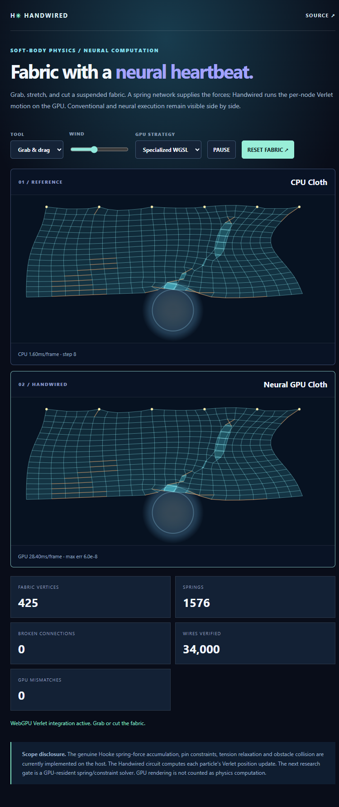

# Handwired Neural Cloth · Visual Lab Experiment 03

Branch created directly from the WebGPU runtime checkpoint `daeb82eb5fbd8f3ec4e919b777421de952e9aa9e`.

## Run

```sh
bun install --frozen-lockfile
bun test ./lab/visual-cloth/model.test.ts
bun scripts/serve-visual-cloth.ts
```

Open http://127.0.0.1:39084/. Use pointer drag to grab the fabric, or choose Cut to tear spring links; adjust wind or select one of three Handwired WGSL strategies. `?smoke=1` forces actual WebGPU execution for eight frames and emits `#smoke` JSON. CPU fallback **never** passes as hardware.

### Numerical and architectural scope

* A real 2-D mesh with horizontal, vertical and diagonal Hooke springs.
* Deterministic spring-force assembly, suspended pins, mouse grabbing, torn edges, an obstacle sphere, and three rounds of distance-constraint relaxation.
* The Handwired circuit executes FP32 Verlet position integration for every vertex, in either CPU or WebGPU batch mode.
* **Host-side:** spring-force assembly, boundary and collision projection, mesh pinning, constraint relaxation and interaction.
* **GPU-side:** the two-output Verlet integration circuit. GPU canvas drawing is separate from the solver.
* Both sides have independent dynamic states and evaluate exactly the same circuit. The GPU lane is checked against an independent CPU reference on its **own input batch**. Tolerance `2e-5` accommodates hardware FP32 differences.
* This is neither a GPU-resident constraint solver nor a complete cloth physics engine; these are explicit future gates.

No trained weights or models.

### Checks

```sh
bun test ./lab/visual-cloth/model.test.ts
bunx tsc -p .
bunx oxlint --type-aware lab/visual-cloth scripts/serve-visual-cloth.ts scripts/verify-visual-cloth-browser.ts
bun scripts/verify-visual-cloth-browser.ts lab/visual-cloth/results/webgpu.json 128 --screenshot
```

The browser smoke verifier checks real WebGPU adapter identification, eight frames and every CPU/GPU circuit wire. It is not a speed claim. Production cloth computation requires porting the spring gathers and constraints onto GPU kernels and avoiding frame-by-frame readback.

## Verified visual and hardware evidence



[View the machine-readable Intel UHD Graphics WebGPU correctness report](results/2026-10-17-dell-webgpu-qa.json). This captured screenshot is of the real application running eight verification frames, not a generated illustration. The evidence establishes full-wire numerical agreement on the tested hardware only; it is not proof of a performance speedup or of hardware behavior on every adapter.

## GPU-resident performance mode (October 2026)

The default live browser mode now renders directly from the resident GPU state, without per-frame GPU-to-CPU buffer mapping or synchronization. The previous hardware-verification and hybrid modes remain selectable. The optimization and reproducible hardware results are documented in [Visual Lab Performance](../../docs/visual-lab-performance.md). This mode is **not** a kernel-only timing benchmark; UI timings show CPU-side dispatch, while synchronized wall-clock timings are in the reports.
