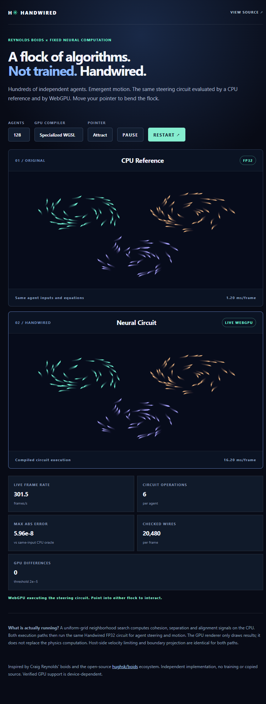

# Handwired Neural Swarm · Visual Lab Experiment 01

This branch is based **directly** on WebGPU baseline `daeb82eb5fbd8f3ec4e919b777421de952e9aa9e`, not on another visual experiment.

## Run

```sh
bun install --frozen-lockfile
bun test ./lab/visual-swarm/model.test.ts
bun scripts/serve-visual-swarm.ts
```

Open http://127.0.0.1:39081/ in Chrome/Edge with WebGPU support. `?smoke=1&count=128` runs eight frames with **required real GPU mode**, writes JSON to `#smoke` and sets `document.body.dataset.status` to `pass` or `fail`. A fallback is never reported as a GPU pass.

## Technical scope

Inspired by Reynolds' boids and open-source boids demos (e.g. [hughsk/boids](https://github.com/hughsk/boids)); the implementation is independent and uses no copied source.

* A CPU uniform spatial hash searches neighbor cells and computes separation, cohesion and alignment sources, per species.
* The 14-source / six-operation Handwired circuit evaluates acceleration, damping and movement.
* CPU reference and actual WebGPU circuit executors share **the same circuit**; the two lanes have independent state.
* A per-frame CPU oracle re-evaluates **the exact GPU input batch** and compares all wires at threshold `2e-5`. This is a hardware-dependent FP32 tolerance, not a claim of universal bit equivalence.
* Boundary and speed projection are host-side on both lanes. The canvas is rendering only.
* The number of agents and compiler strategy are configurable.

### What remains

The boids neighbor search is currently host-side; it has **not** yet been ported to GPU. A fully GPU-resident flock requires a neighbor-grid/scatter/gather stage or equivalent GPU spatial partitioning beyond the current per-instance Circuit API. Frame timings include source upload and GPU readback, and should not be compared as GPU-only kernel timing. Test in a real WebGPU browser before publishing performance claims.

No pretrained model, gradients or learning are used.

## Verification gates

```sh
bun test ./lab/visual-swarm/model.test.ts
bunx tsc -p .
bunx oxlint --type-aware lab/visual-swarm scripts/serve-visual-swarm.ts
```

For a project-specific WebGPU smoke test run the browser at `/?smoke=1&count=128` in real GPU mode, wait until eight frames complete, and capture the `#smoke` JSON. Preserve adapter, browser, mismatch count and timing in an evidence artifact.

## Verified visual and hardware evidence



[View the machine-readable Intel UHD Graphics WebGPU correctness report](results/2026-10-17-dell-webgpu-qa.json). This captured screenshot is of the real application running eight verification frames, not a generated illustration. The evidence establishes full-wire numerical agreement on the tested hardware only; it is not proof of a performance speedup or of hardware behavior on every adapter.
